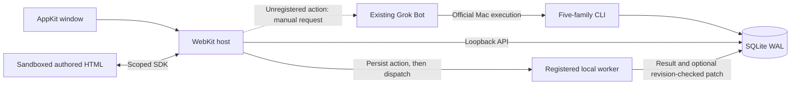

# Architecture

Grok owns application authoring and business logic. Grok Spaces owns only the
local host, persistence, revision checks and action/result transport.

## Components

- `native/`: AppKit/WebKit, placement, service ownership, selection deep links,
  user-initiated copy/export and isolated WebKit smoke checks.
- `web/`: generic Bot/Space navigation, HTML sandbox, Data and Activity.
  `space-sdk.js` is injected before authored scripts. No built-in business app.
- `bridge/store.py`: SQLite, JSON Merge Patch, consistent reads, revision checks,
  atomic publication/completion and idempotent actions.
- `bridge/server.py`: standard-library HTTP service bound to `127.0.0.1`.
- `bridge/local_worker.py`: durable per-event claims and bounded execution of
  Grok-authored, CLI-registered project-local Python handlers.
- `bridge/preview.py`: disposable browser preview using the real SDK and mocked
  actions. It neither imports nor executes the local worker runtime.
- `bridge/cli.py`, `contract.py`, `prompts.py`: six public command families (`init` scaffolds
  `scaffold.py` starter source and registers the worker)
  and concrete instructions scoped to one installation/Bot/Space.
- `bridge/mcp_probe.py`: isolated research fixture, not the product connection.

## Data and identity

One local database under `~/Library/Application Support/Grok Spaces/` is authoritative.
A stable installation ID scopes device verification. Bots have stable local IDs
and names; these are explicit associations, not Grok account authentication.
Every operation supplies a Space ID. Each Space belongs to one Bot and stores
HTML, JSON state and revision. Bot-authored source lives under `projects/SPACE_ID`.

Writes take `BEGIN IMMEDIATE`, validate the caller's expected revision and commit
all affected fields together. Readers use a consistent SQLite snapshot. A stale
write fails with 409; the host never silently upgrades an old edit's revision.
HTML plus initial state publish in one transaction.

Actions have stable IDs, creation sequence numbers and pending/completed/failed
status. A request ID identifies one logical action; changed input with the same
ID is refused. Completion and optional state patch are atomic. Exact repeated
completion returns the saved result; a different completion is refused.
Completion also appends an audit event so creation cursors discover result-only
updates. The original action remains authoritative. Pending counts cover all
rows, independently of the latest-50 detail view and 200-entry history pages.

## Rendering and lifecycle

Only the selected Space is synchronized. HTML changes replace the iframe;
ordinary state/result updates do not. Space ID and per-frame epoch bind SDK
messages to the selected iframe, preventing a stale frame from writing to another
Space. Foreground polling and refresh-after-write deliver external CLI changes
without a daemon, SSE or WebSockets. Activation refreshes saved data.

The native host serves packaged resources, not the current directory. It reuses
a service only when app identity and canonical data directory match, and stops
only its own process. Deep links select existing Bot/Space objects; they cannot
create objects or execute code.

## Trust boundaries

The service rejects unexpected Host/Origin and cross-site requests, requires JSON
mutations, and exposes no filesystem or shell endpoint. It is a single-user local
tool; processes with that user's rights can access the database.

HTML uses `sandbox="allow-scripts"`, an opaque origin and network-blocking CSP.
The SDK exposes selected-Space data/actions only. Native copy/export accepts only
the owned main frame at the exact loopback origin; export uses a save panel.

HTML, action payloads, results and fetched data remain untrusted. A recorded action
does not authorize unrelated external side effects. Credentials, proprietary
Grok bundles and runtime databases stay outside Git. The host does not invoke
a model; a registered handler may invoke its own services. Registration trusts
local code running as the current user, and the authored page to invoke its
allowed actions, including from startup/timers. There is no enforced click or
human approval boundary. Python isolation is not an OS sandbox. HTML cannot
register code. See [Security](SECURITY.md) for the complete trust boundary.
Unregistered actions remain manual. Official Bot wakeup and native Page
publication are separate, currently unpaired capabilities.

## Compatibility and provenance

The signed Grok Bot app is unchanged. Native Pages were tested separately;
MCP Apps gates are not changed or treated as account-availability evidence.
Public evidence and limits are recorded in [verification](docs/verification.md).
Internal development history and runtime artifacts are excluded from the public
source snapshot. The public repository starts with an independently reviewed
clean source commit.
