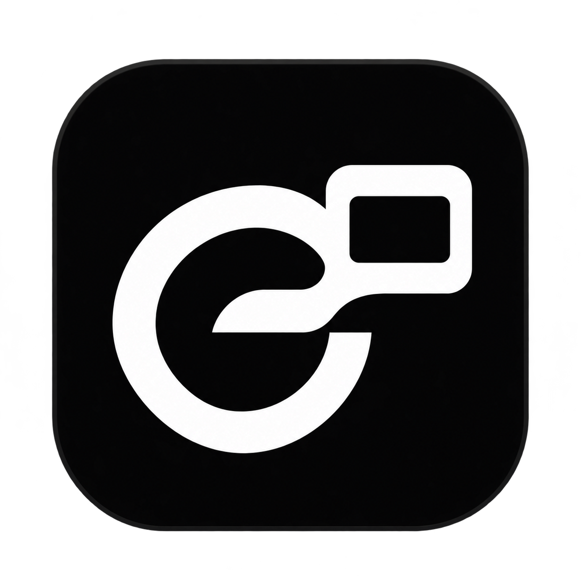

# Grok Space

> Install Grok Space on this Mac: https://github.com/onehumanbeing/grok-space/blob/main/INSTALL.md

<div align="center">



Persistent HTML workspaces for your existing Grok Bot on macOS. Grok writes the
page and its business logic; this project supplies a small host, saved state and
an action/result bridge. The signed Grok app remains intact.

English · [简体中文](README.zh-CN.md)

Built by Henry · [X @iamhenryyuan](https://x.com/iamhenryyuan)

[](https://github.com/onehumanbeing/grok-space/actions/workflows/ci.yml)

</div>

[Author SDK](web/README.md) · [Architecture](ARCHITECTURE.md)

[Minimal page and handler](examples/minimal/README.md) · [Verification](docs/verification.md) · [MIT license](LICENSE)

For one-command setup and the sentence to give Grok, start with [INSTALL.md](INSTALL.md).
Currently macOS only; see its tested/untested compatibility matrix.

For an agent installing or authoring a Space: use the user's authorized **local
Mac execution**, reuse this CLI and SDK, and confirm the installation and Space
references. Do not use a cloud machine in its place, print keys, start login or
permission flows, remove quarantine, or disable Gatekeeper. Read before writing
and pass the revision that was actually read; never substitute a newer revision
to force an old edit through. Use `read --summary` or selected `--field` values
for large states; request HTML or history only when needed.

## Preview the example

```bash
./scripts/preview-space --html examples/minimal/index.html --state examples/minimal/state.json
```

Open the printed local URL. This developer preview uses a disposable store and
the real SDK, with clearly mocked actions. It does not execute handlers, connect
a Bot, or establish native-app acceptance.

## Run

Requires macOS 14+, Xcode Command Line Tools (Swift and `/usr/bin/python3`), and
Grok Bot with official execution access to this Mac. No package install is needed.

```bash
./scripts/build-app.sh
open "out/Grok Spaces.app"
./scripts/grok-space doctor
./scripts/grok-space open --bot "My Bot" --create-bot --title "My Space" --show
```

The AppKit/WebKit window follows Grok without moving it. **Space → Standalone**
lets you place it freely. Limited space falls back to a clamped floating window.
The app starts a service on `127.0.0.1:8789` and stops only the service it owns.
Closing the window quits the app; your data survives.

Data: `~/Library/Application Support/Grok Spaces/`. Keep this folder when updating.
The initial database is empty. A Bot association is an explicit local label,
not an authenticated Grok identity or automatic detection of the current chat.

## Give a Space to your Bot

Use the returned `refs.space_id` in subsequent calls. In the window, use
**… → 安装与连接… → 复制当前页面的连接指令** and send it in the matching Bot conversation.
The Bot must confirm this Mac's installation ID, read the [SDK](web/README.md),
author its HTML in the returned `project_dir`, and publish through the same CLI.

```bash
./scripts/grok-space read --space SPACE_ID --summary
./scripts/grok-space publish --space SPACE_ID --expected-revision 0 \
  --html-file /absolute/path/index.html --patch-file /absolute/path/initial.json
./scripts/grok-space action status --space SPACE_ID
./scripts/grok-space action get --space SPACE_ID --event EVENT_ID
./scripts/grok-space action complete --space SPACE_ID --event EVENT_ID \
  --expected-revision 1 --file /absolute/path/result.json
```

The five public families are `doctor / open / read / publish / action`. They
return JSON, including factual errors and recovery guidance. Use files for long
or untrusted data rather than shell interpolation. Publish can update HTML,
state, or both atomically; stale revisions are rejected. Default reads return
saved data; request HTML explicitly with `read --space SPACE_ID --html`, or
history with `read --space SPACE_ID --events`.

## What a page can do

The host injects `window.spaces` before the authored page's scripts:

```js
const current = await spaces.get();
const saved = await spaces.patch({ filter: "online" }, {
  expected_revision: current.revision,
});
const request = await spaces.action("refresh_data", {}, {
  expected_revision: saved.revision,
  requestId: crypto.randomUUID(),
});
spaces.subscribeEvents(event => showResult(event.status, event.result));
```

Keep durable values in Space state. HTML is self-contained, network-free and
sandboxed. The SDK provides no filesystem, shell or parent-DOM access.
See the [full contract](web/README.md) for retries and subscriptions.

Grok can write a local handler and register its allowed action types through
`action worker register`. A page action then saves an event, automatically runs
that handler and receives the committed result in the same Space. The host does
not invoke a model; a handler may make its own model or service calls. See
[local workers](docs/local-workers.md) for a small JSON handler, registration,
revision conflicts and duplicate protection.

Registration trusts both the local code and the page to invoke its allowed
actions. Page scripts can invoke them on load or a timer; a physical click and
human approval are **not enforced**. Handlers run as the current user, outside an
OS sandbox. Review the [security boundary](SECURITY.md) before registering code
with external effects. Never rerun a side effect just because its state commit
conflicted.
Unregistered action types remain manual. Automatic Bot webhook delivery and
native Pages publication are not configured; copying alone never sends a request.

## Native route and status

On Grok Bot 0.79.2, a real Bot created, read and edited one private native Page.
Independent UI checks confirmed its button, Library reopening and pinning; the
button's temporary state reset on reopen. A persistent page-to-Bot bridge was
not exposed by the tested tools, so the foundation uses a thin companion and
official local execution. Native Pages remain useful for Bot-authored reports.
No private chat API, renderer patch, feature-gate override or cloud service is used.

Evidence and remaining checks: [verification record](docs/verification.md).
Native MCP probe tests verify protocol compatibility offline, not availability
on a Grok account. Native Pages publication is planned separately from this
working local foundation.

## Development

```bash
/usr/bin/python3 -m unittest discover -s tests -v
node --check web/app.js
node --check web/space-sdk.js
./scripts/build-app.sh
/usr/bin/python3 tests/native_smoke.py
```

Tests use isolated stores. Set `GROK_SPACES_DATA_DIR` and `GROK_SPACES_PORT` on the
built executable for manual isolation, or pass `--data-dir` to the CLI.
Selection deep links deliberately refuse a non-default data folder.
The [browser integration suite](tests/ui_README.md) uses an owned Playwright
browser and disposable stores. CI runs it alongside the Python suite, native
build, signature verification and WebKit startup check.

[Contributing](CONTRIBUTING.md) · [Security](SECURITY.md) ·
[Support](SUPPORT.md) · [Changelog](CHANGELOG.md) ·
[Community conduct](CODE_OF_CONDUCT.md) · [Release process](docs/releasing.md)

Released under the [MIT license](LICENSE). The companion is an independent
project; it does not modify or redistribute the Grok client. Native Pages
one-click publication remains planned; the local foundation works independently
of that connection.
