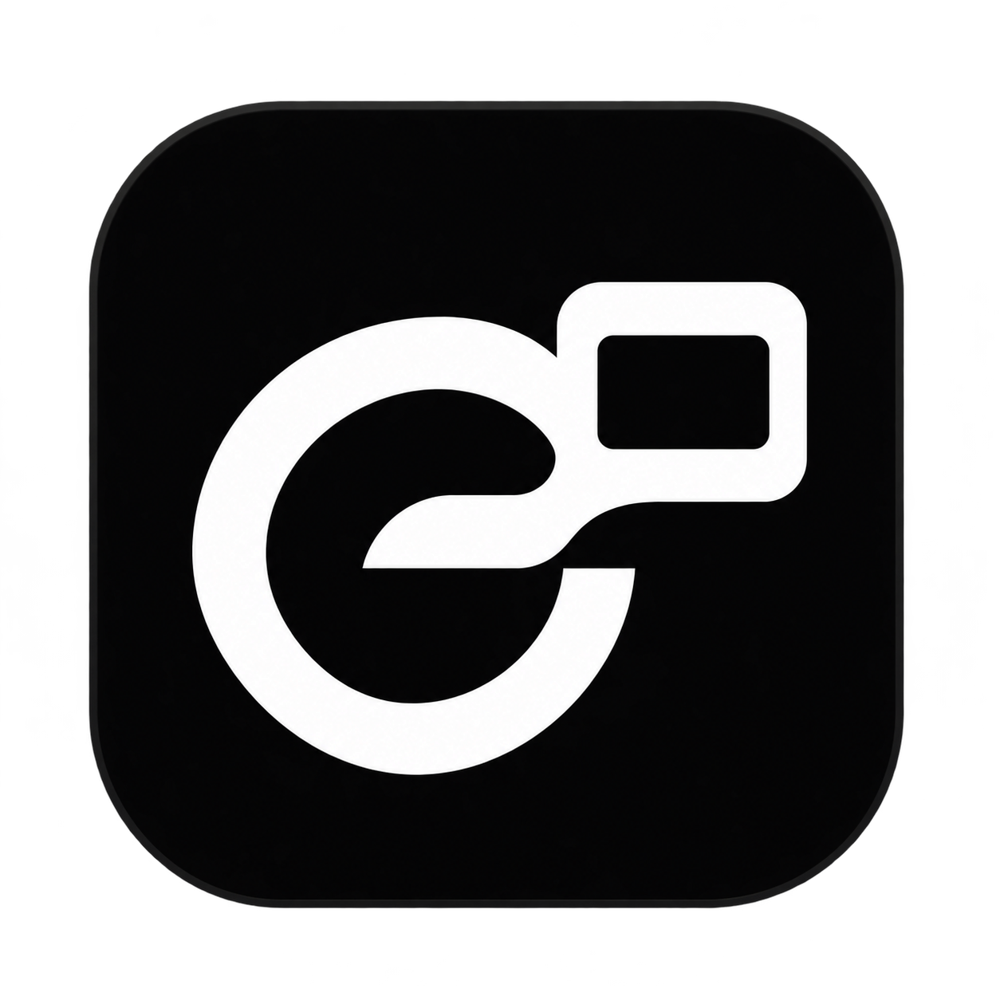

# Grok Spaces

> Install Grok Spaces on this Mac: https://github.com/onehumanbeing/grok-spaces/blob/main/INSTALL.md

<div align="center">



给现有 Grok Bot 增加可保存的 HTML 工作空间。Grok 编写页面和业务代码；本项目只做
Mac 薄窗口、持久状态及交互记录与结果回传，不改动 Grok 客户端。

[English](README.md) · 简体中文

Henry · [X @iamhenryyuan](https://x.com/iamhenryyuan) · [小红书 袁老板讲黑客松（Henry）](https://www.xiaohongshu.com/user/profile/5eb444030000000001000194)

[](https://github.com/onehumanbeing/grok-spaces/actions/workflows/ci.yml)

</div>

[HTML SDK](web/README.md) · [架构](ARCHITECTURE.md)

[最小页面与处理器](examples/minimal/README.md) · [验证记录](docs/verification.md) · [MIT 许可](LICENSE)

一句话交给 Grok 安装的方法见 [INSTALL.md](INSTALL.md)，当前仅支持 macOS。

交给 Agent 时：使用用户已授权的这台 Mac 本地执行，复用现有 CLI 和 SDK，先核对
installation 与 Space 引用。不要改用云端电脑、打印密钥、发起登录或系统授权、移除
quarantine 或关闭 Gatekeeper。写入必须带实际读取的 revision，不能换成新版本强行覆盖。
大状态先用 `read --summary` 或 `--field` 读取所需字段，只在需要时取 HTML 或历史。

先预览最小示例：

```bash
./scripts/preview-space --html examples/minimal/index.html --state examples/minimal/state.json
```

打开输出的本地网址。预览使用临时数据和真实 SDK，动作有明确模拟标签；不执行处理器，
也不证明已连接 Bot 或通过原生应用验收。

需要 macOS 14+、Xcode Command Line Tools，以及能在这台 Mac 官方本地执行命令的 Grok Bot。

为兼容已有 Bot 配置，CLI 继续使用原名称 `grok-space`。

```bash
./scripts/build-app.sh
open "out/Grok Spaces.app"
./scripts/grok-space doctor
./scripts/grok-space open --bot "我的 Bot" --create-bot --title "我的 Space" --show
```

在窗口 **… → 安装与连接… → 复制当前页面的连接指令**，发给对应 Bot。Bot 核对设备和
installation ID 后，在返回的 `project_dir` 写自包含 HTML，通过 CLI 发布。
入口只有 `doctor / open / read / publish / action` 五组，均返回 JSON。

窗口采用 Grok 相近的系统字体、白灰配色和紧凑布局，可跟随 Grok，也可在 **Space →
Standalone** 独立摆放。Space 保存 HTML、筛选、数据和动作结果，退出后仍保留。
数据目录为 `~/Library/Application Support/Grok Spaces/`，更新时请保留。

页面通过注入的 `window.spaces` 读写状态、记录动作并接收结果。HTML 不直接联网、不访问
文件或执行命令。每次写入带读取时的版本，过期写入会拒绝，避免覆盖新数据。

Grok 编写本地 Python 处理器，通过 `action worker register` 注册允许的动作类型后，
页面动作会自动保存 Action、调用 worker 并把结果回到同一页面。宿主不调用模型；
处理器自身仍可以选择调用模型或其他服务。
注册同时信任代码和页面使用这些动作：页面脚本可在加载或计时器中触发，**没有强制
真实点击或逐次人工审批**。处理器以当前用户权限运行，不是 OS 沙箱。带外部副作用的
代码先看[安全边界](SECURITY.md)；状态冲突不能成为重复执行副作用的理由。
详见[本地 worker](docs/local-workers.md)。未注册的动作仍需
交给 Bot；原生 Pages 发布及自动 webhook 唤醒尚未连接，复制不代表发送。

已用真实 Bot 验证原生 Page 创建、编辑、Library 重开及固定；原生按钮状态在重开后归零，
因此补伴随窗口承载持久交互。未修改签名客户端或绕过功能开关。
详细状态见[验证记录](docs/verification.md)。

采用 [MIT 许可](LICENSE)。本项目是独立伴随工具，不修改或分发 Grok 客户端。原生 Pages
一键发布仍属计划，不影响当前本地基础能力独立使用。

[贡献](CONTRIBUTING.md) · [支持](SUPPORT.md) · [安全](SECURITY.md) ·
[更新记录](CHANGELOG.md) · [社区规范](CODE_OF_CONDUCT.md)
